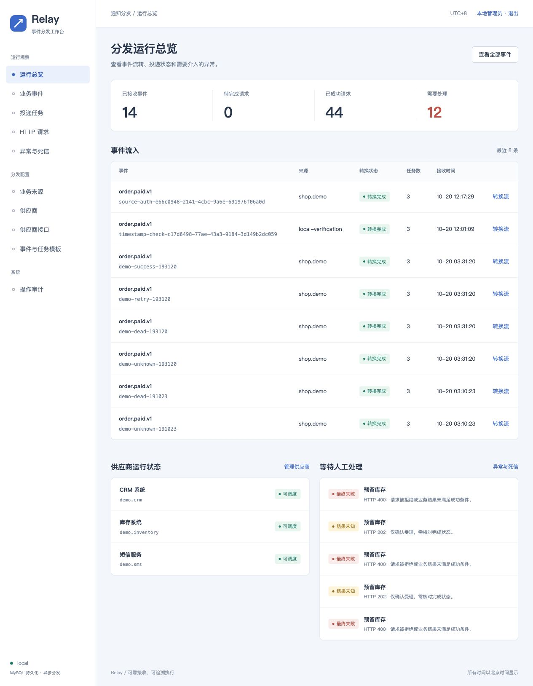
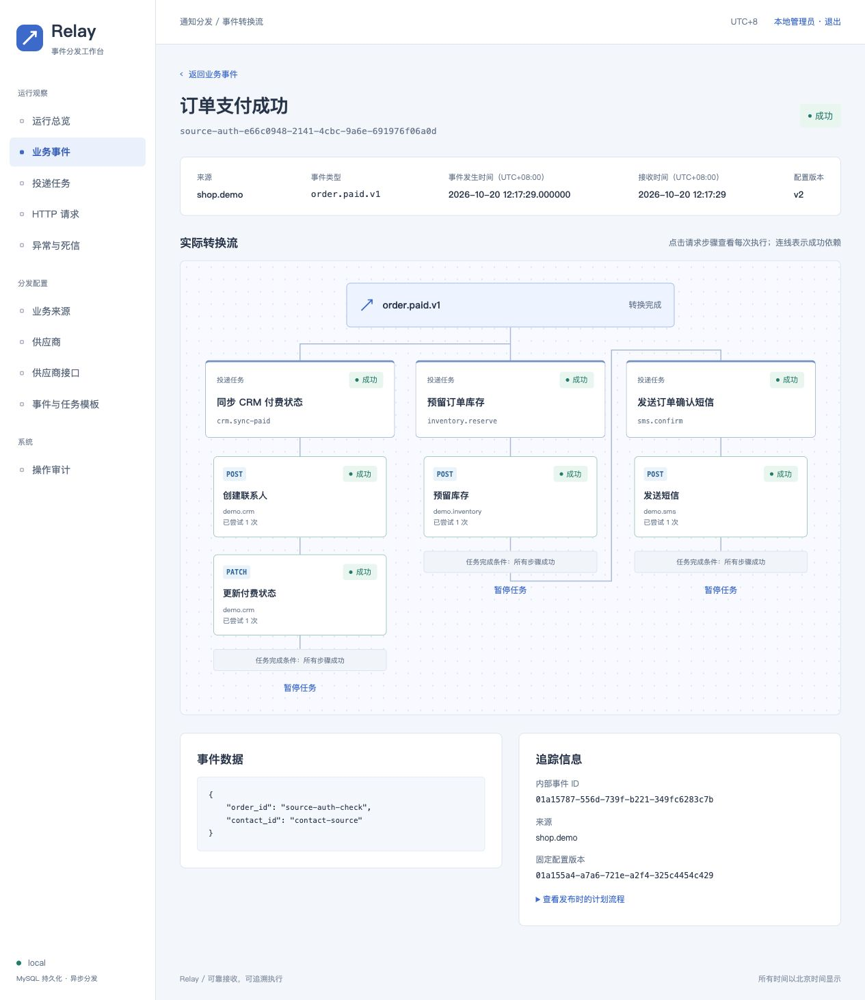
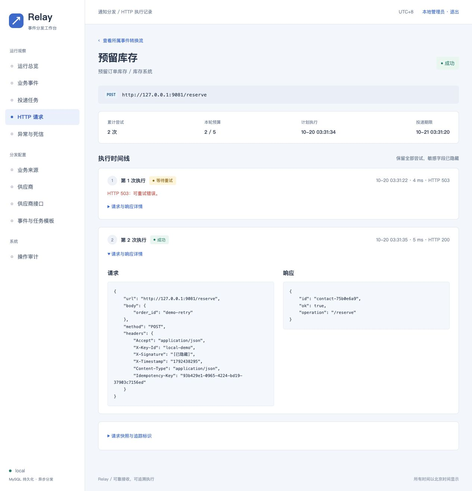
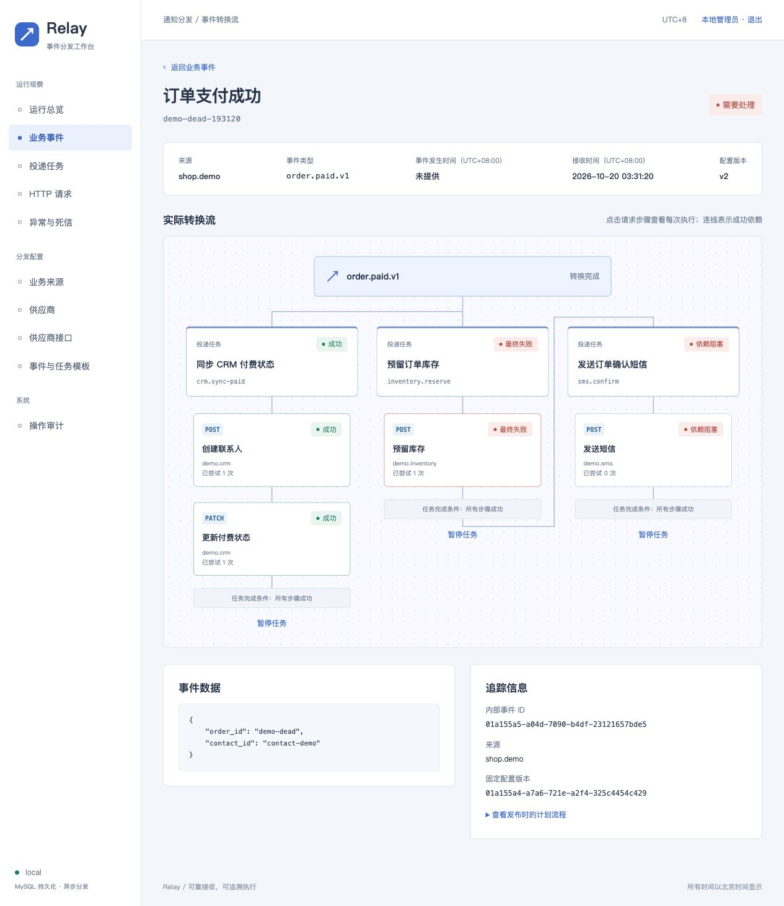
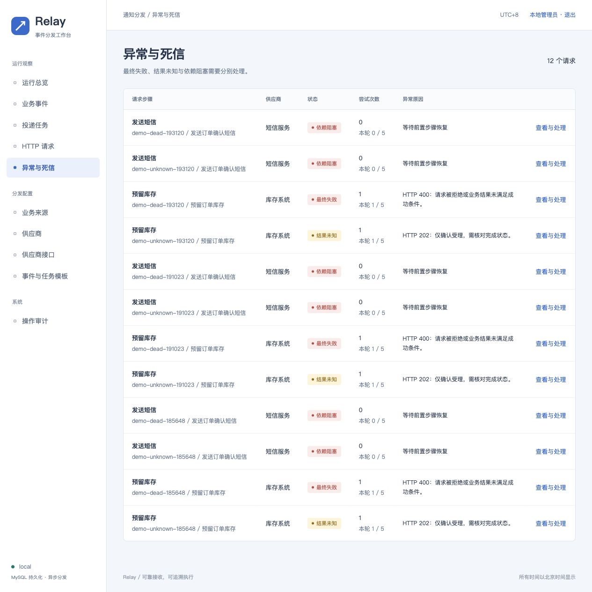
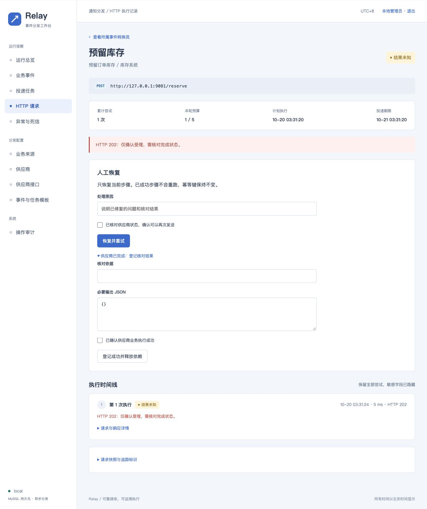
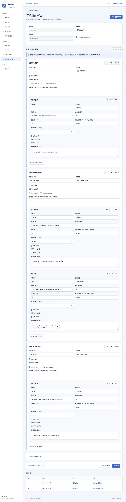
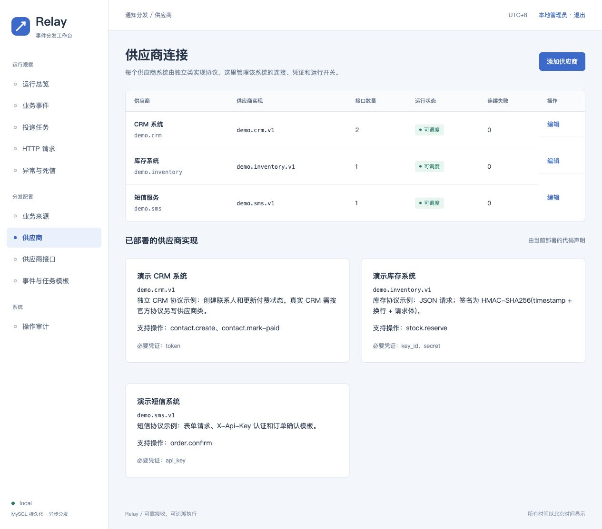
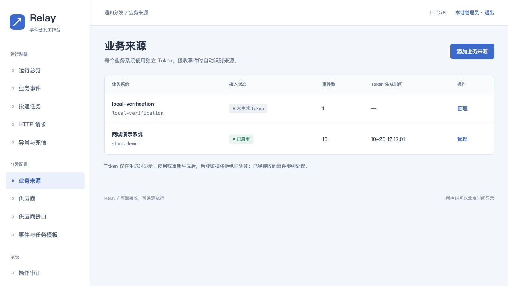

## 前言：

一般我是将需求原样直接发给AI，让它先开放式思考一下，这样可以避免被自己的经验所限以及AI模型的过度迎合。然后再根据自己的经验和实际来进行挑选和缩窄。

但是目前我个人理解AI也有些局限性：在技术架构和创新上还略有不足，更适合进行确定边界后的代码实现；AI现实考虑因素较少，有时过度的政治正确，并且无法对结果负责，有时比较理想化。

可能是由于上下文压缩，导致也会出现前后不一致的情况，例如设计数据库时没有考虑消息的来源系统名称，但是后续使用中，它又给设置了来源系统字段。这个是一个比较初步的设计和实现，还需要实际的校验使用中，进行调整。

## 1. 系统边界

### 哪些问题你选择在这个系统中解决？

- **基础的概念定义：** 采用事件驱动机制，需要定义这三个实体：事件、投递任务、任务实现（HTTP请求），一个事件可能有多个投递任务，一个投递任务可能调用多个HTTP请求，失败重试和调用异常在任务实现层；事件到任务到HTTP请求的转换，需要具有可回溯可观测，以便于处理异常时进行处理。提供给上游的http接口应该是一个，但是到下游分发时按照供应商要求进行请求。

- **两个业务对象：** 业务系统（作为信息生成商，虽然可能有多个来源，但是他们可以统一使用一种请求形式，共享鉴权，只是payload不同），供应商（多个，且请求方式不同，鉴权方式不同）

- **消息的持久化：** 不丢信息，出错时可以恢复重新执行，至少保证接收到的信息不丢失；

- **同步异步：** 实现常驻事件监听，信息异步处理，避免一方出错影响其他供应商API以及拖慢执行进度。

- **供应商的管理：** 增加修改供应商的配置便利性，同时一个供应商可能有多个API，可以考虑共用一个车事件推送的接口和多个供应商类实现的思路。

- **异常处理：** 供应商的接口超时等处理时不应该影响其他部分的运行，以及更重要的自身系统出错后的处理，要求自身代码具备反复执行性，而非一次性程序或者不可逆执行，并且可由人工进行恢复手动执行等。异常的过度重试容易造成大量信息堆积导致系统崩溃。

- **事件接收和处理顺序：** 需要注意单个供应商处推送对顺序的要求，以及多个供应商之间的顺序要求，有些请求需要确定两个事件的先后顺序，不然程序出错，例如取消订单要在下单之后，发送订单确认短信也要在去除库存之后。有些情况是前置依赖要求必须上一个成功，才能调用下一个。

- **信息的幂等：** 考虑对供应商或者接口进行分级，一类接口要求幂等性，一致性要求高（可以多次推送都采用同一个KEY标识一个事件的多次推送去重）要进行状态查询，另一类要求低，无需状态查询，他们可能自己处理去重，重复推送也不会影响业务。

- **推送的即时性：** 有些任务时要求尽快推送，而有些对时效性要求不高，甚至可能要求为一天一次定时推送。

- **配置复杂性：** 由于系统内有较多的供应商密钥、接口地址、对应的供应商业务类路径等配置，考虑动态性可以在数据库存储，实现后台可配置，但要注意代码和数据库的匹配，做一层启用校验。

### 哪些问题你明确选择不解决？为什么？

- **不设计信息回流：**

  这个系统连接供应商系统和业务系统的，但是我理解他们并非双方透明对等的关系，而且处理好这三者的边界，能有效的降低复杂度。例如业务系统无需知道我推送给了哪些供应商。也无需向业务系统告知供应商方的处理结果。业务系统遇到事件，只需推送给转发这个分发系统。这样是一个简单的信息单向流动的结构，出现问题也好定位。所以应该把设计重点放到分发上。

- **不进行二次数据查询：**

  该系统用于推送的数据，应该全部来自接收到的事件的payload中，而不应该自己再去二次查询数据。自己做二次查询实际上可能会造成数据的篡改，造成紊乱。可以对数据进行封装，修改字段的名称和数据类型转换，以符合不同供应商接口的要求。这样更加简洁，出问题时，尽量去业务系统的payload和供应商接口上考虑。

- **供应商配置无代码化：**

  实际情况中，可能做不到彻底的纯配置化，零编码，或者比较难做到。理想中就是在后台直接配置，无需更改任何代码，直接配置字段转换方式，请求方式等等。

- **业务系统来源的颗粒度：**

  来源的颗粒度粗一些，一个系统算是一个来源，一套token。例如订单系统、销售系统、项目管理系统、应急系统。而不是在一个系统中再向下细分，可能会造成分级的紊乱，而且暂时看不到颗粒度更细区分的收益。可后续考虑。

## 2. 可靠性与失败处理

> 你选择的通知投递语义是什么？（例如：至少一次、其他）
>
> 在外部系统失败或长期不可用的情况下，你的处理策略是什么？

选择**至少一次投递**。在外部系统失败或长期不可用，可以采用**有限重试（有限时间或者有限次数）+ 熔断策略**，供应商熔断后，暂时下线该供应商，并考虑是否有替代如有替代则调用替代API，如果没有进入失败信息列表由告警人工处理。

## 3. 取舍与演进

### 在 AI 的方案建议中，你认为哪些设计是“过度的”，并选择不采纳？

- **保障最终一致性的对账机制**，系统运行时间长了之后，再加上接口请求的延迟，其实可能会出现多个系统数据不一致的情况，通常需要增加一些定期的对账机制，核对某些关键双方信息字段保障最终一致性。但是这种设计实际落地是比较难的，可能要投递状态对账以及业务数据对账。

- AI会理想化认为每个供应商的调用都是需要**OAuth 2.0**的机制，都需要换取token，但是实际情况未必是这样，有些使用Client ID 和Client Secret换取token，有些可能就是固定长效token。而且他会把对各个供应商的http请求也封装了，认为无非是Post或者Get请求，在后台配置一下即可，实际远非如此。

- 在事件ID之外，又增加了一个**business_key**字段，这个字段用来填入类似订单号这种的内容，可以查看同一订单的下的操作。但是对非订单类业务用不到，担心会造成冗余没有采用。后续需要可以在payload中增加。

- **供应商校验**，由于供应商一部分配置在数据库，还有一部分是写到代码中的，由于可能上线和配置未必同步，但是目前并没有实现在启用供应商时，去校验代码相关配置和文件是否存在。这个比较实用，但是考虑在供应商较多时实现，也可能将来实现无代码纯后台配置供应商。

### 如果这是一个第一版系统，未来流量或复杂度显著增长时，你会如何演进？

- **字段转换可视化：** 事件转换成投递任务时，由于每个供应商的字段要求不同，例如可能事件进来的payload是一个比较大的JSON，但是实际上给供应商时要从中拣选，并非全部推送。这方面最好做成可视化界面或者静态可配置的文件，而非写死到代码中，可以看到具体的转换操作（例如字段名更换、数据类型转换），这样利于查找问题。

- **性能效率优化：** 未来扩展时，可根据拆分再进一步拆分，加强多个Worker的处理效率，可实现供应商的请求速率管理、负载分配等。

---

# Relay · 内部事件分发服务

Laravel 12 + MySQL + Redis。接收业务事件，生成投递任务，并按依赖关系执行 HTTP 请求。提供中文管理后台。

## 本机启动

项目目录：`/Users/chao/dev/notification-dispatcher`。

本机已安装 PHP 8.4、MySQL 8.4 和 Redis。数据库与 Redis 数据保存在本项目的 `storage/mysql`、`storage/redis`，未配置开机启动。

```bash
cd /Users/chao/dev/notification-dispatcher
./bin/local-services start
./bin/dev
```

打开 <http://127.0.0.1:8088>。账号、随机密码和接入 Token 保存在 `storage/app/local-access.json`（仅本机，文件权限 0600）。该文件不要提交到代码仓库。

`bin/dev` 同时启动 Web、恢复扫描器、按供应商隔离的 Worker 和本地模拟供应商。Ctrl+C 停止应用进程。使用 `./bin/local-services stop` 停止项目专用 MySQL 和 Redis。

端口：Web 8088，模拟供应商 9081，MySQL 3307，Redis 6381。均绑定回环地址。

## 已实现

- 单一接入接口；Token 鉴权；持久化成功后确认受理。
- 语义化事件类型、任务模板、供应商连接和 API 标识；UUID 实例 ID。
- 同一来源和事件 ID 去重；内容冲突返回 409。
- 发布版本固定；事件转换与任务创建在同一数据库事务内完成。
- 任务 DAG、任务内请求 DAG、前序输出映射、跨事件前置依赖。
- 请求级有限重试、稳定幂等键、执行租约、过期回收、旧结果写入隔离。
- Redis 丢失消息后，从 MySQL 恢复；已完成步骤不重复领取。
- 供应商独立队列、串行执行、速率限制、熔断和暂停开关。
- 每个供应商一个实现类；CRM、库存、短信示例分别实现 JSON、签名和表单协议。
- 立即、延迟、每日定时发送；任务触发条件；事件必填字段。
- 事件、任务、HTTP 尝试、转换流、死信与跨事件链路查询。
- 供应商/API 编辑；可视化任务模板编辑；校验、发布和历史定义重新发布。
- 人工重试、未知结果核对、任务暂停/恢复、操作审计。
- 凭证加密、表单敏感字段禁止回填、日志脱敏、目标网络限制。

## 新环境安装

需要 PHP 8.2+（建议 8.4）、Composer 2、MySQL 8.4、Redis 7+。PHP 需要 PDO MySQL、mbstring、OpenSSL、cURL、pcntl。测试另需 PDO SQLite。后台使用 Blade 与原生 JavaScript，无需前端构建。

```bash
composer install
cp .env.example .env
php artisan key:generate
# 编辑 .env：数据库和 Redis；接入 Token 在后台“业务来源”中生成
php artisan migrate --force
php artisan dispatch:admin admin@example.com
```

不要对已有数据库重新生成 APP_KEY；已有供应商凭证与步骤输出使用此密钥加密。备份数据库时也要安全备份 APP_KEY。

分别启动常驻进程：

```bash
php artisan serve --host=127.0.0.1 --port=8088
php artisan dispatch:listen
php artisan dispatch:workers
```

`dispatch:workers` 每 3 秒发现新供应商，为每个供应商启动一个 Worker。生产环境使用进程管理器或容器管理这些进程。部署新代码后，重启监听器与 Worker；不要只刷新 Web。

`php artisan db:seed` 只添加指向回环地址的演示配置，不会提交业务事件。生产环境不要启用本地目标访问。

## Docker Compose

仓库提供 PHP-FPM、Nginx、MySQL 和 Redis 的容器配置。当前机器没有 Docker，容器构建未在本机执行；原生 MySQL/Redis 路径已验证。

准备 `.env`，设置 APP_KEY、DB_PASSWORD、MYSQL_ROOT_PASSWORD 后执行：

```bash
docker compose build
docker compose up -d mysql redis
docker compose run --rm app php artisan migrate --force
docker compose run --rm app php artisan dispatch:admin admin@example.com
docker compose up -d
```

Web 绑定 `127.0.0.1:8088`。对外使用时，在受控入口配置 HTTPS、访问控制及安全 Cookie。容器模式不启用模拟供应商或回环目标。

## 接入协议

每个业务来源使用独立 Token，由后台“业务来源”生成、停用或重新生成。来源由 Token 确定，请求体不再填写 `source` 和 `business_key`；提交这两个字段返回 422。旧共享 `DISPATCH_API_TOKEN` 配置已移除。完整升级与鉴权说明见 [业务来源接入说明](docs/source-auth.md)。

```http
POST /api/events
Authorization: Bearer <该业务系统的 Token>
Content-Type: application/json
Accept: application/json
```

```json
{
  "id": "payment-20261020-001",
  "type": "order.paid.v1",
  "occurred_at": "2026-10-20T09:30:00.123+08:00",
  "payload": {
    "order_id": "42",
    "contact_id": "contact-7"
  }
}
```

- 首次接收返回 202 和内部事件 ID。
- 相同内容再次提交返回 200、同一内部 ID 和 `duplicate: true`。
- 相同来源和事件 ID 携带不同内容时返回 409。
- 未发布的事件类型、非法依赖或缺少必填字段返回 422。
- 达到待处理事件容量阈值时返回 503。上游应稍后重试。
- 单次事件大小上限为 1 MiB。

同一来源中的事件 ID 应保持唯一。同一次业务事件重试提交时，不要生成新 ID。

### 事件发生时间

`occurred_at` 由业务系统提供，表示业务事件实际发生的时间；数据库 `created_at` 表示分发系统接收并保存事件的时间。两者分开记录。

- 格式：带时区的日期时间，例如 `2026-10-20T09:30:00+08:00` 或 `2026-10-20T01:30:00.123Z`；小数秒可省略，最多 6 位。统一转为 UTC，以 `DATETIME(6)` 保存。
- 为兼容已有调用，字段可省略或为 `null`。历史记录保留空值，后台显示“未提供”，不以接收时间补造发生时间。新接入方应提供此字段。
- 不接受 Unix 数字时间戳、无时区时间、无效日期或闰秒。数据库支持的 UTC 年份范围为 1000–9999；时间校验失败返回 422。
- 重试必须保持发生时间不变。相同时间的时区和小数位表示会规范化后去重；改变实际时间返回 409。首次未提供、重试才补填也属于内容变化。
- 模板通过 `$event.occurred_at` 读取规范化的 UTC 字符串，例如 `2026-10-20T01:30:00.123000Z`，可映射到供应商参数；未提供时映射结果为 `null`。
- 时间戳用于追踪和下游业务参数，不自动决定依赖顺序或过期时间。迟到事件可以接收，未来时间也不代表定时投递。调用顺序仍由显式依赖控制，调度时间仍由任务配置控制。

### 跨事件顺序

取消订单可以携带 `"predecessor_id": "order-created-42"`。前置事件必须属于同一鉴权来源，可以晚到；缺失时任务等待，不推断网络到达顺序。系统拒绝循环；其他来源的同名事件不会满足此依赖。

可靠性从 202 受理开始。上游业务事务到事件提交之间，需要调用方使用 Outbox 或其他可靠提交机制。

## 模板配置

后台先创建供应商连接，再创建 API，最后建立事件模板。模板草稿可以保存不完整内容；发布必须通过校验。API 操作从对应供应商类的声明中选择，不能自行填写 HTTP 协议。

最小定义：

```json
{
  "required_payload_fields": ["order_id"],
  "tasks": [{
    "key": "inventory.reserve",
    "name": "预留订单库存",
    "enabled": true,
    "depends_on": [],
    "when": {},
    "steps": [{
      "key": "reserve",
      "name": "预留库存",
      "endpoint_id": "inventory.reserve",
      "enabled": true,
      "depends_on": [],
      "input": {"order_id": "$event.payload.order_id"},
      "max_attempts": 5,
      "ttl_seconds": 86400,
      "delay_seconds": 0
    }]
  }]
}
```

- 任务 depends_on 引用任务 key。步骤 depends_on 引用同任务内的步骤 key。
- 引用前置输出必须同时声明依赖关系。支持传递依赖。
- `$steps.create.output.id` 引用本任务已成功步骤的输出。
- `$tasks.inventory.reserve.steps.reserve.output.id` 引用前置任务的步骤输出。
- task.when 为所有字段相等的过滤器，例如 `{"payload.channel":"ads"}`。不匹配的任务记为未触发，其依赖任务保持阻塞，不将跳过视为成功。
- required_payload_fields 是 payload 内的必填字段路径，可在高级 JSON 编辑器中设置。
- daily_at 使用 `HH:mm`，默认时区 Asia/Shanghai。每个事件只安排一次，在下一个指定时刻发送；不是自动产生每日事件，也不合并多条事件。配置 daily_at 时覆盖 delay_seconds。
- 任务/步骤关闭只影响新发布版本；供应商连接关闭会暂停该连接上已有任务的领取。
- 上下移动只改变显示顺序。执行顺序以 depends_on 为准。
- 已接收事件绑定发布版本。修改接口后，需要发布模板新版本；旧任务保留原接口快照。
- 凭证在发送时读取，以支持轮换。不要把已有连接改成另一个业务账号；应创建新的连接 ID，避免旧任务使用错误账号。

## 供应商实现与 Driver 扩展

一个具体供应商系统对应一个类。相同系统的多个账号或环境可以复用该类，分别建立连接。不是按 JSON、Form、HMAC 等传输方式选择 Driver。

当前代码提供三个独立的演示供应商：

| Driver ID | 类 | 业务操作 | 协议 |
|---|---|---|---|
| demo.crm.v1 | DemoCrmDriver | contact.create、contact.mark-paid | Bearer；创建用 POST JSON，更新用 PATCH 和联系人路径参数 |
| demo.inventory.v1 | DemoInventoryDriver | stock.reserve | JSON；HMAC-SHA256(timestamp + 换行 + 原始请求体) |
| demo.sms.v1 | DemoSmsDriver | order.confirm | X-Api-Key；URL 编码表单 |

这些是本地模拟系统的协议，不代表任何真实产品。真实 CRM、项目管理系统等应按各自 API 文档新增专用类，不直接复用演示协议。

供应商类位于 `app/Drivers/Suppliers`，继承 `SupplierDriver`，实现：

- `manifest()`：供应商稳定 ID、名称和必要凭证字段。
- `operations()`：可用 API 操作，含语义 ID、请求方式、路径、必填业务输入和幂等能力。
- `prepare(endpoint, credentials, input, key)`：按操作构造实际请求。可以在同一类中使用不同的 HTTP 方法、Header、Body 和签名方式；返回 `PreparedRequest`。
- `interpret(endpoint, response)`：读取完整 HTTP 响应，包括状态码、Header 和原始 Body。自行解析协议，返回 `DeliveryResult(status, output)`；output 可供后续依赖步骤映射使用。

HTTP 执行、超时、租约、持久化和调度仍由执行器统一负责，供应商类不自行发送请求或执行重试。一个 API 对应一个请求步骤；多个 API 的顺序在模板中声明。

新增真实供应商时：编写类 → 在 `Registry::SUPPLIERS` 注册 → 部署全部 Worker → 在后台创建连接 → 选择代码声明的 API 操作 → 配置模板并发布。不允许通过数据库指定任意 PHP 类路径。

后台只配置连接地址、凭证、超时、开关和业务编排。接口表增加 `operation`；`method` / `path` 是展示缓存。保存和发布时从类声明重新解析协议；请求体构造、业务成功条件和幂等能力不能被表单覆盖。发布时检查操作存在、凭证齐全、必要输入已映射和依赖有效。

已有连接不能切换 Driver，以免历史任务读取其他供应商的凭证。更换实现请创建新连接。协议发生不兼容变化时使用新 Driver ID，并保留旧类直到历史任务处理完毕；发布快照固定 Driver ID 与操作，不冻结 PHP 代码。

旧 `JsonHttpDriver`、`FormHttpDriver` 和 `HmacJsonDriver` 仅作为内部请求构造工具及历史快照兼容实现，不出现在新连接选项中。已有通用 Driver 连接可以轮换凭证，但不能继续发布新的通用接口流程。本机演示连接已转换到专用类，并发布 v2；v1 历史快照未改写。

升级已有环境先运行 `php artisan migrate --force`，然后重启常驻监听器和 Worker。不要重跑初始化脚本覆盖已有配置。

## 投递与恢复语义

MySQL 是事实来源，Redis 只负责唤醒。扫描器恢复待转换事件、过期执行租约和未被及时领取的请求。Redis 丢失唤醒后，最多等待 120 秒重新入队；供应商限速导致的暂缓不等待该恢复期限。

同一步骤允许重复发送，幂等键保持稳定。自动投递受最大次数及 TTL 限制；最终失败保留记录，不保证无限期最终成功。

HTTP 超时最多 30 秒，Worker 超时 45 秒，执行租约 90 秒，Redis retry_after 120 秒。修改时保持此顺序。HTTP 调用在数据库事务外执行，结果只有在租约 token 仍有效时才能写入。

每个供应商一次只执行一个请求，扫描器每秒为每个可用供应商安排一个请求。因此当前实现面向中小规模通知，单供应商调度上限约每秒一次。提高并发需要扩展供应商租约为并发槽位，并压测后调整。

- 超时、连接中断及部分服务器错误：幂等接口可自动重试；非幂等接口转结果未知。
- HTTP 202：只确认受理，进入结果未知，不释放后续依赖。
- 参数错误或业务成功条件不满足：最终失败，不自动重试。
- 429：按退避和 Retry-After 安排下一次发送。
- 最终失败：人工修复后恢复当前步骤，开启新的有限重试周期。
- 结果未知：先到供应商处核对。可以登记成功和必要输出；或确认可安全重发后恢复。
- 前序失败：后续显示依赖阻塞；修复前序后自动重新判断。已过投递期限的后续步骤需要单独人工恢复。

本版不提供任意原请求参数修改或按新模板自动重放历史事件。配置快照问题需要修正 Driver 兼容性，或在明确业务影响后提交新的业务事件。不要直接编辑数据库中的已发布版本。

## 观测与运维

```bash
php artisan dispatch:tick      # 单轮转换、恢复与调度
php artisan dispatch:health    # JSON 指标；Redis 不可用或监听心跳超时返回非零
php artisan queue:restart     # 通知队列 Worker 退出，由 supervisor 重启
```

后台展示转换流、历史尝试、异常死信和人工操作审计。最终失败及未知结果写入 `dispatch.requires_attention` 告警日志；外部短信、邮件或企业 IM 告警通道未配置。可以由现有监控系统收集 health 输出和应用日志。

需要监控 MySQL 磁盘、队列积压、最老待执行时间、失败数量及熔断状态。当前不自动删除历史数据；生产部署应确定保留期限和归档流程，避免因历史记录无限增长耗尽存储。

管理账号均为内部操作员，具有全部管理能力；本版不包含多租户、细粒度角色权限或 SSO。输入/响应按敏感字段名脱敏；业务接入前，应按真实数据结构扩展 `Redactor`。

## 测试

```bash
./bin/php artisan test
./bin/php vendor/bin/pint --test
```

自动测试默认使用内存 SQLite，不接触实际供应商。真实 MySQL 验证在专用 `notification_dispatcher_test` 数据库执行：

```bash
./bin/php tests/Integration/mysql-suite.php
./bin/php tests/Integration/intake-race.php
```

第二条会重建专用测试库，内置库名保护；不要将测试库与业务库共用。并发测试覆盖跨业务依赖、重复 ID 冲突和容量上限。

测试覆盖事件去重、契约校验、转换原子性、依赖、重试预算、租约恢复、旧结果隔离、Redis 故障、供应商暂停、配置发布、权限、凭证保护和受限网络访问。

## 代码导航

- `app/Dispatch`：发布校验、事件转换、依赖推进、执行、恢复和人工操作。
- `app/Drivers`：供应商请求构建与响应判定。
- `app/Models` / `database/migrations`：持久化模型。
- `app/Http/Controllers` / `resources/views`：API 和管理后台。
- `public/assets`：后台样式、调用链绘图、可视化模板编辑器。
- `tests/Feature` / `tests/Unit` / `tests/Integration`：行为与并发测试。
- `docs/design.md` / `docs/implementation-plan.md`：设计与实施记录。

Laravel 队列与超时配置参考：[官方队列文档](https://laravel.com/docs/12.x/queues)。

## 后台运行 Demo

以下截图采集于 **2026-10-20**，来自正在运行的本地后台及实际执行记录。CRM、库存和短信均使用本地模拟供应商。失败与结果未知记录是特意保留的演示场景，便于查看异常定位和恢复入口。截图文件保存在 `docs/screenshots/`。

演示流程为：`order.paid.v1` 事件生成库存、CRM、短信三个任务。CRM 内部先创建联系人，再更新付费状态；短信任务必须等待库存任务成功。CRM 与库存可以独立处理。

### 1. 运行总览

入口：`/`。查看已接收事件、待完成请求、成功请求、待处理异常，以及各供应商是否可调度。下方可以直接进入最近事件和异常请求。



### 2. 事件 → 任务 → HTTP 请求

入口：业务事件 → 转换流。一个事件展开成三个任务、四个 HTTP 请求步骤。图中同时展示任务依赖、步骤依赖、执行状态和尝试次数；顶部区分事件发生时间与接收时间，并显示固定的模板版本。

这条记录已全部成功：CRM 的 `POST 创建联系人 → PATCH 更新付费状态` 顺序执行，库存成功后才发送短信。



### 3. 失败重试与执行时间线

入口：HTTP 请求 → 预留库存。`demo-retry` 场景第一次返回 HTTP 503，经过退避后第二次返回 HTTP 200。每次执行都保留独立记录，不覆盖之前的失败。

展开详情可查看实际请求、供应商响应和幂等键。截图中的签名字段已脱敏。



### 4. 前置失败只阻塞依赖分支

入口：业务事件 → `demo-dead` → 转换流。库存接口返回 HTTP 400，库存任务进入最终失败；依赖库存的短信任务被阻塞，尚未发出请求。独立的 CRM 任务仍然成功。

事件顶部汇总为“需要处理”，但各任务保留自身状态，便于定位真正失败的节点。



### 5. 异常与死信列表

入口：`/dead-letters`。集中展示最终失败、结果未知和依赖阻塞，并列出供应商、尝试次数及异常原因。通过“查看与处理”进入对应请求的执行记录和恢复入口。



### 6. 结果未知与人工恢复

入口：异常与死信 → `demo-unknown` 的库存请求。演示供应商返回 HTTP 202，只表示受理，系统因此保留“结果未知”，不会直接放行后续短信。

操作员核对供应商状态后，可以选择“恢复并重试”，或填写核对依据和必要输出，登记成功并释放依赖。恢复只针对当前步骤，已成功步骤不会重跑。截图仅展示处理入口，未提交人工确认或重试。



### 7. 事件与任务模板配置

入口：事件与任务模板 → 订单支付成功。配置任务与步骤的语义标识、开关、前置依赖、参数映射、尝试上限、延迟和有效期。

图中 CRM 第二个步骤依赖“创建联系人”，并通过 `$steps.create.output.id` 使用前一步输出；短信任务依赖“预留订单库存”。草稿保存与发布分开，底部保留版本历史。上下移动只改变显示顺序，执行顺序由依赖关系决定。

<details>
<summary>展开完整模板配置长图</summary>



</details>

### 8. 供应商与代码实现

入口：`/providers`。查看每个供应商连接所绑定的 Driver、接口数量、运行状态和连续失败次数。下方展示当前部署的供应商实现、支持的操作和所需凭证字段。

CRM、库存、短信分别对应独立实现类，负责各自的 HTTP 协议、认证和成功判定；后台负责连接配置与运行开关。



### 9. 业务来源与独立 Token

入口：`/sources`。按业务系统管理独立接入凭证，查看来源状态、事件数量和 Token 生成时间。来源由鉴权结果确定，上游请求无需填写 `source`。

Token 只在生成时展示，列表不回显明文；来源可停用，也可重新生成 Token。截图中未生成 Token 的历史来源尚未开放接入。


